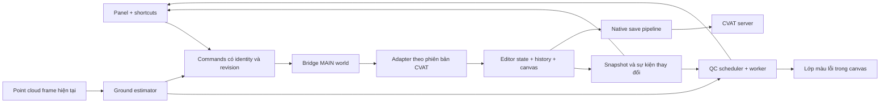

# Kế hoạch hoàn thiện CVAT 3D Copilot

Ngày lập: 06/10/2026. Baseline: extension 1.1.0; server kiểm tra trả version 2.76.0. Trạng thái: **kế hoạch triển khai, chưa phải tính năng đã hoàn thành**.

Kế hoạch này thay thế thứ tự kỹ thuật của các roadmap cũ. Giữ các tài liệu cũ làm tham khảo; không dùng checklist hoặc ROI trong đó làm bằng chứng hoàn thành. Đối chiếu [báo cáo kiểm chứng](README_VERIFICATION.md) và [JSON kết quả](verification/readme-verification.json).

> Cập nhật bản demo 1.2: ưu tiên hạn 2–3 ngày theo [DEMO_GUIDE.md](DEMO_GUIDE.md). Geometry, adapter native và demo offline đã viết; math/mock/browser demo đã kiểm thử. Các mốc bên dưới chỉ được đánh dấu nghiệm thu khi chạy trên CVAT thật, gồm native Save/reload.

## 1. Kết quả sản phẩm cần đạt

| ID | Yêu cầu | Tiêu chí nghiệm thu |
|---|---|---|
| R1 | Ground Snap một nút | Đọc ground cục bộ từ LiDAR, giải thích độ tin cậy, cập nhật đúng box đang chọn ngay trên tất cả viewport liên quan; thiếu bằng chứng ground thì không snap tự động |
| R2 | Xoay -90/+90/180° | Tâm và kích thước không đổi; yaw đúng theo quy ước đã kiểm chứng; canvas cập nhật, undo/redo được |
| R3 | Free Cam thực sự | Camera perspective di chuyển độc lập bằng phím, nhìn bằng chuột, có tốc độ chậm/nhanh; tắt/blur thì dừng và trả điều khiển cho CVAT |
| R4 | Auto QC và màu/class | Theo dõi chỉnh sửa, chỉ rõ box + loại lỗi + số đo + ngưỡng; tô màu mức lỗi trong 3D; hỗ trợ người dùng đổi class qua luồng native |
| R5 | Realtime không refresh | Panel, canvas, selection và QC cùng phản ánh trạng thái hiện tại khi sửa/đổi frame; lưu server có trạng thái riêng, không dùng reload để cập nhật hình |
| R6 | Chọn box hoặc lỗi → CVAT chọn đúng box | Activate đúng object trong canvas và sidebar, kể cả box mới chưa lưu; chiều CVAT→tool cũng đồng bộ |

Mặc định sản phẩm: QC là lớp hiển thị và danh sách lỗi riêng, **không tự biến class `vehicles` thành một class tên lỗi**. Người dùng đổi class đối tượng bằng selector riêng; màu QC tạm thời có thể bật/tắt. Không tự suy ra sai semantic class hoặc đầu/đuôi chỉ từ kích thước box. Nếu cần lưu lỗi vào CVAT Issues, đó là bước tích hợp riêng có schema và quyền ghi cụ thể.

Realtime không đồng nghĩa mỗi frame render phải gọi REST. Thay đổi hiện ngay trong editor; trạng thái lưu phân biệt `Unsaved / Saving / Saved / Save failed`. Bản đầu dùng cùng cơ chế Save của CVAT; nếu bật autosave thì đi qua cơ chế đó, không tạo luồng PATCH song song.

## 2. Quyết định kiến trúc

**CVAT editor state là nguồn sự thật cho phiên đang làm việc.** REST dùng metadata/read-back; không thay thế dữ liệu chưa lưu bằng snapshot server hoặc cache demo.



### 2.1 Adapter CVAT

Giao diện nội bộ dự kiến, tên dưới đây là API của Copilot, không khẳng định có sẵn trên `window` của CVAT:

```ts
interface CvatAdapter {
  capabilities(): Capabilities;
  getSnapshot(): EditorSnapshot;
  subscribe(listener: (event: EditorEvent) => void): () => void;
  selectObject(ref: ObjectRef): Promise<CommandResult>;
  updateGeometry(ref: ObjectRef, edit: GeometryEdit): Promise<CommandResult>;
  updateLabel(ref: ObjectRef, labelId: number): Promise<CommandResult>;
  getPointCloud(frame: number): Promise<PointCloudHandle>;
  setQcAppearance(result: QcResult): void;
  setFreeCamera(enabled: boolean): Promise<CommandResult>;
  dispose(): void;
}
```

- Khảo sát build frontend thực tế, không suy ra chắc chắn từ version API backend.
- Ưu tiên instance/callback có sẵn của editor và hành vi native. Mã upstream có `Canvas3D.activate(clientID)` và `focus(clientID)`; phải xác nhận có thể truy cập instance và đồng bộ sidebar ở bản nội bộ.
- Nếu extension không lấy được pipeline chỉnh sửa hoặc camera qua điểm tích hợp ổn định: chốt phương án hook nhỏ trong frontend CVAT nếu có quyền sửa, hoặc adapter giới hạn tính năng rõ ràng. Không tuyên bố hoàn tất bằng cách đoán tên mesh/địa chỉ memory.
- Việc tìm React Fiber nếu cần chỉ cô lập trong adapter cho phiên bản đã test, có timeout và capability detection. Không quét lại toàn cây mỗi lần gõ phím.
- Không gán trực tiếp Redux state hoặc sửa mesh để giả làm annotation update. Không match box bằng khoảng cách vị trí.
- Adapter chưa nhận diện: panel báo không tương thích và khóa thao tác ghi; có thể cho đọc nếu capability đã xác nhận.

### 2.2 Identity, frame và trạng thái

`ObjectRef = { sessionId, jobId, frame, objectType, clientId, serverId? }`.

- Chọn object trong editor bằng clientID. serverID dùng cho persistence/đối chiếu; không ghép hai ID bằng OR.
- Box mới chưa lưu có clientID nhưng có thể chưa có serverID.
- Shape và track phân biệt; track lấy hình học nội suy từ editor ở frame hiện tại. Chỉnh track qua luồng native tạo keyframe đúng, không gửi track thành shape.
- Chỉ audit cuboid hợp lệ đang thuộc frame; định nghĩa rõ filter visibility/outside/hidden. Đề xuất audit box hiện hữu kể cả hidden với toggle, bỏ outside; locked được audit nhưng không sửa.
- Đổi job/frame: tăng generation, hủy worker/request cũ, bỏ kết quả có revision/generation sai, xóa selection không còn hợp lệ.

### 2.3 Bridge và command

- Message dạng allowlist: `GET_SNAPSHOT`, `SELECT_OBJECT`, `ROTATE`, `SNAP_GROUND`, `SET_LABEL`, `SET_QC_APPEARANCE`, `FREECAM`, `DISPOSE`.
- Mỗi command có requestId, protocolVersion, job/frame/session, expectedRevision. ACK gồm trạng thái và revision sau khi editor nhận thay đổi; persistence ACK riêng.
- Kiểm tra payload hữu hạn, shape/type/ID/frame đúng, permission/locked và chế độ vẽ hiện tại. Reject command cũ hoặc trùng requestId.
- Không truyền credential, URL tùy ý, JavaScript tùy ý hoặc ObjectState chứa prototype qua message.
- MAIN world cùng trust boundary với trang; nonce/channel giúp tránh va chạm, không coi nó là cơ chế bảo vệ khỏi script cùng origin. Ràng buộc command vào job hiện tại và quyền native.
- Một hàng đợi thay đổi cho mỗi object; vô hiệu thao tác trùng đang chờ hoặc serialize rõ. Không retry mù lệnh cộng góc khi kết quả chưa xác định.
- Timeout/rejection: khôi phục preview hoặc reconcile từ snapshot hiện tại, không ghi đè các chỉnh sửa mới hơn. Save fail giữ trạng thái unsaved theo CVAT để người dùng retry.

## 3. Lộ trình theo mốc bàn giao

Ước lượng cho một người có quyền truy cập môi trường test và frontend: **24–35 ngày làm việc**, cộng dự phòng 20–30% cho tích hợp. Đây là ước lượng, không phải cam kết. Điểm chưa chắc nhất là khả năng truy cập pipeline editor, point cloud và camera. Chốt lại sau M1.

| Mốc | Thời lượng | Phụ thuộc | Đầu ra |
|---|---:|---|---|
| M0 — Baseline và tách demo/live | 1–2 ngày | Không | Test harness, chế độ rõ ràng, bỏ success giả và cache sai job |
| M1 — Khảo sát và adapter read/selection | 3–4 ngày | M0 | Đọc đúng frame + selection hai chiều, capability report |
| M2 — Ghi native và xoay box | 3–4 ngày | M1 | Rotate realtime, save/undo/redo, xử lý lỗi |
| M3 — QC nền + màu lỗi + class | 4–5 ngày | M2 | Rules, cập nhật tự động, chọn lỗi, lớp màu, đổi class |
| M4 — Point-cloud ground và snap | 5–7 ngày | M1, M2; tích hợp M3 | Ground cục bộ có confidence, snap/ground QC |
| M5 — Free Cam | 3–5 ngày | M1; có camera capability | Flight controls, tương thích input và reset |
| M6 — E2E, hiệu năng và pilot | 5–8 ngày | M2–M5 | Bản release candidate và bằng chứng nghiệm thu |

Mốc demo có ích đầu tiên là cuối M2: chọn đúng box + xoay trực tiếp + undo/save đáng tin cậy. Không cần chờ ground và camera để kiểm chứng nền tảng realtime.

### M0 — Baseline và sửa những hành vi gây hiểu nhầm

1. Lưu baseline script, hash, fixture và kết quả kiểm chứng README; xác định repo/version-control phù hợp vì thư mục hiện chưa được Git nhận diện là repository.
2. Tách `demo` và `live` rõ ràng. Cache chỉ được tải khi người dùng chọn demo; demo không có đường gọi API ghi. API lỗi ở live phải giữ dữ liệu đúng job hoặc báo disconnected, không tự đổi sang 9426.
3. Bỏ server/job/org/token mặc định khỏi bản release; nhận job và origin từ CVAT session. Metadata label lấy đầy đủ pagination. Tách cấu hình per-origin/per-job.
4. Xử lý `TypeError` như lỗi kết nối, không return success. Thông báo chỉ nói điều đã xác nhận: editor updated khác với server saved.
5. Sửa click issue theo issueId; clipboard có nút riêng, không copy ngầm khi người dùng chỉ muốn chọn box.
6. DOM dùng textContent cho tên label/error; validate input và không chèn dữ liệu server vào innerHTML không escape.
7. Phím tắt bỏ qua input/textarea/select/contenteditable/modal; khảo sát xung đột phím native trước khi chốt mặc định. `Alt+L` có xung đột theo docs CVAT.

**Nghiệm thu:** mô phỏng offline/401/403/timeout không có success giả; mở job khác không nạp cache 9426; demo không gửi request ghi; nhãn chứa ký tự HTML chỉ hiện như text.

### M1 — Adapter đọc và đồng bộ lựa chọn

1. Ghi fingerprint frontend, extension load order và cách bridge MAIN↔ISOLATED hoạt động.
2. Probe có giới hạn để lấy editor state, current frame, selection, labels, ObjectState, canvas instance, quyền và save state; viết compatibility record cho build đã thử.
3. Đưa snapshot về panel, chỉ giữ DTO thuần cần thiết. Subscribe state/editor events; fallback polling nhẹ chỉ khi chưa có event ổn định và phải đo chi phí.
4. Map clientID/serverID riêng. Chọn dropdown hoặc dòng lỗi gọi select; chờ event selection xác nhận trước khi hiển thị selected thành công.
5. Khi chọn box bằng canvas/sidebar, panel cập nhật cùng box. Chặn vòng lặp phát selection qua lại.
6. Activate đúng box trước; focus camera là nút/tùy chọn riêng để không giật góc nhìn khi chọn liên tiếp.
7. Theo dõi SPA navigation, frame load, delete, create, undo/redo; dispose toàn bộ listener cũ khi rời job.

**Nghiệm thu:** ít nhất 20 lần chọn liên tiếp qua dropdown/lỗi/canvas/sidebar, không nhầm ID; box mới chưa lưu; track ở frame nội suy; box bị xóa; đổi frame khi snapshot đang trả về. Mỗi lần chỉ đúng một object active, panel và CVAT khớp, không refresh.

**Điểm quyết định:** nếu chỉ đọc được metadata API mà không có state/canvas đáng tin cậy, chưa được bước sang ghi realtime. Ghi rõ phần hook frontend cần thêm thay vì dùng match tọa độ.

### M2 — Luồng chỉnh sửa native và xoay

1. Bọc luồng chỉnh geometry native tương ứng build; cập nhật ObjectState qua API/callback đã khảo sát, phát lại render và history đúng cơ chế CVAT.
2. Implement -90/+90/180 theo yaw, giữ x/y/z và size; normalize góc theo quy ước được xác nhận từ data và editor. Xác minh tail của points không bị mất.
3. Bảo đảm một click là một thao tác history; double click xử lý tuần tự. Không patch REST cạnh tranh native autosave.
4. Xử lý locked/readonly, đang drag/draw, box bị xóa, frame đã đổi, stale revision.
5. Hiển thị trạng thái chỉnh sửa và save riêng. Reconcile khi lỗi; không rollback đè lên edit mới.
6. Test shape và track; chỉnh frame nội suy tạo keyframe theo native, không phá quỹ đạo ngoài phạm vi native edit.

**Nghiệm thu:** 4×90° trở về góc tương đương ban đầu, 2×180° tương tự; mọi viewport cập nhật; native undo/redo đúng một bước; save rồi GET read-back đúng; mở lại job vẫn đúng. Thử mất mạng khi save, 403, lệnh đến muộn và thao tác liên tiếp.

### M3 — QC tự động, màu và class

1. Tách engine thuần khỏi panel, cấu hình rule theo label ID và project. Unknown class hiện `No rule configured`, không áp vehicles ngầm.
2. Validate point array, số hữu hạn, dimension >0, layout/unit/Euler được hỗ trợ; dữ liệu sai trả lỗi có tên, không tiếp tục tính ground/collision.
3. Kiểm đầy đủ min/max L/W/H, tỷ lệ trục, các thuộc tính bắt buộc nếu có schema đã thống nhất. Ngưỡng theo rubric; các kích thước bất thường là cảnh báo cần xem, không tự kết luận sai class.
4. Với box upright: footprint xoay + giao chiều cao để tính oriented 3D IoU; broad phase bằng spatial grid/AABB để giảm số cặp. Box có roll/pitch ngoài miền hỗ trợ thì ghi `UNSUPPORTED_ORIENTATION`, hoặc triển khai OBB đầy đủ rồi mới bật rule. Không dùng khoảng cách tâm làm bằng chứng overlap.
5. Cặp overlap có pairKey để không đếm hai lần trong tổng lỗi; cả hai box có thể liên kết đến cùng lỗi. Dashboard phân biệt số box lỗi với số mục lỗi.
6. Ground rule tạm trạng thái `Ground unavailable` cho đến M4; không dùng mặt phẳng suy từ box để phát lỗi chắc chắn. Sau M4 dùng confidence và uncertainty để phân biệt lỗi với nghi vấn.
7. Subscribe edit/create/delete/label/frame/undo; debounce đề xuất 150ms, recompute box thay đổi và các lân cận. Full scan khi đổi frame hoặc rule; nút Scan vẫn dùng snapshot editor mới nhất.
8. Worker trả `{job, frame, generation, revision, ruleVersion}`; bỏ kết quả cũ. Cancel/coalesce khi kéo box; không chạy full O(n²) trên mỗi mousemove.
9. Issue gồm issueId, objectRef/pairRef, code, severity, confidence, message, measured, expected, ruleVersion, suggestedAction. Nhóm lỗi theo box, lọc severity/class/code, giữ selection khi lỗi vừa hết.
10. Tô viền màu trong canvas: đỏ lỗi nặng, vàng cảnh báo; có legend và nhãn text. Không thay label chỉ để đổi màu. Selected box vẫn nhận biết được; clone/restore material đúng phạm vi, không đổi shared material của box khác. Tắt QC hoặc rời frame trả màu gốc.
11. Class selector dùng label hợp lệ của task; đổi qua M2/native history; validate attributes khi chuyển class. Không auto đổi class do một rule kích thước.

**Nghiệm thu:** tạo/sửa/xóa và undo làm issue/màu cập nhật; click từng lỗi của một box chọn đúng box và copy đúng lỗi đó; sửa lỗi xong màu trở về; đổi class cập nhật sidebar/rule/save/undo; overlap có ground-truth hình học; unsupported/unknown hiện rõ.

### M4 — Ground từ LiDAR và snap

1. Lấy point cloud frame hiện tại qua data/canvas interface đã xác nhận. Xác minh units, up-axis, transform LiDAR→world→box trước khi fit.
2. Xây spatial index và voxel downsample một lần mỗi frame; cache theo frame + data revision, không sao chép toàn bộ cloud giữa worlds mỗi click. Dùng worker và transferable buffer khi phù hợp với quyền sở hữu buffer.
3. Với box A, lấy vùng cục bộ quanh footprint và một vành lân cận; giới hạn bán kính hợp lý theo class/density. Loại NaN/inf và điểm có khả năng thuộc vật thể; không phụ thuộc hoàn toàn vào box hiện tại để loại ground khi box đang sai.
4. Chọn ứng viên thấp cục bộ, RANSAC plane với prior normal gần trục up, refine least squares từ inliers. Giới hạn slope theo môi trường đã gán nhãn; không dùng global z-cut trên đường dốc dài.
5. Ground estimate trả plane/normal, số điểm/inliers, residual, spatial coverage, confidence và lý do reject. Kiểm vùng hỗ trợ đủ quanh footprint để không extrapolate từ một cụm điểm xa.
6. Xử lý nền nhiều tầng, mép vỉa hè, cầu/dốc, cây/bụi, sparse LiDAR, điểm trên nóc xe. Nếu không tách ground đáng tin, hiển thị unavailable hoặc yêu cầu người dùng chọn vùng ground; không fallback âm thầm về z=0.
7. Preview ground patch và ΔZ trước thao tác khi confidence thấp. Mặc định chỉ đổi vị trí theo trục up, không đổi yaw/pitch/roll hoặc size.
8. Với mặt phẳng `z=ax+by+c` và các đỉnh đáy đã transform, tính clearance `z_i-a*x_i-b*y_i-c`. Dịch Z để clearance nhỏ nhất về zero: `deltaZ = -min(clearance_i)`. Kiểm thêm các đỉnh còn lại nếu cuboid nghiêng lớn; trường hợp ngoài miền hỗ trợ phải reject.
9. Đáy box giữ nguyên hướng trên đường dốc thường không thể toàn bộ cùng áp mặt phẳng. Định nghĩa mặc định: **điểm thấp nhất tiếp xúc, không xuyên đất**. Tự align pitch/roll với normal là tính năng riêng, chỉ làm nếu rubric yêu cầu và người dùng chọn.
10. Submit snap qua M2 với revision/cloud generation kiểm tra lại. QC ground dùng cùng estimator nhưng không coi kết quả snap tự nó là ground-truth.

**Nghiệm thu:** flat/slope/roll-pitch synthetic có nghiệm đã biết; box cố tình nâng/chìm không làm ground chạy theo; cảnh sparse/multiple-level phải reject đúng. Trên tập frame có ground do reviewer xác nhận, đo median/p95 error và coverage riêng. Mục tiêu ban đầu: p95 sai số cao độ ≤5cm ở các vùng đủ điểm và được chấp nhận; sai số phép snap vào plane đã biết ≤1mm. Ngưỡng phải hiệu chỉnh bằng dữ liệu thực, không tuyên bố chính xác ±2cm trên mọi cảnh.

### M5 — Free Cam thực sự

1. Xác định camera perspective và cơ chế render/control ownership đúng build. Giới hạn ảnh hưởng perspective, giữ camera orthographic cho chỉnh box.
2. Chuyển camera control qua adapter; lưu pose/target/control settings trước khi bật. Không dựa vào canvas đầu tiên trong DOM.
3. Movement bằng `requestAnimationFrame` và deltaTime: WASD trên vector camera, QE theo world-up; chuột điều chỉnh yaw/pitch, giới hạn pitch, tốc độ có slow/fast và scale phù hợp scene.
4. Quản lý keydown/keyup, blur, visibility, focus vào input, mở modal, rời job; clear pressed keys và dừng loop để không trôi camera.
5. Escape thoát; nút Reset/Fit và tùy chọn trở lại pose ban đầu. Không bắt chuột/phím khi đang thao tác annotation hoặc panel.
6. Bật/tắt nhiều lần không nhân listener/loop; phối hợp lifecycle canvas để renderer native không lập tức ghi đè camera.

**Nghiệm thu:** giữ tổ hợp phím có chuyển động liên tục, tốc độ gần như độc lập FPS; không sửa box; blur dừng; tắt trả controls; đổi frame không treo; xác nhận cả Chrome và Edge có extension.

### M6 — Nghiệm thu live và phát hành

1. Tạo/chuẩn bị job test có dữ liệu đại diện, riêng với production; test ghi chỉ trên dữ liệu được xác định là dùng cho thử nghiệm. Lưu snapshot trước/sau và restore nếu cần.
2. Dùng extension thật qua manifest để test cả MAIN/ISOLATED world. Test mock DOM và demo không được tính là E2E.
3. Ma trận: shape/track, mới/chưa lưu, locked/hidden/outside, nhiều frame, project nhiều label, đổi job qua SPA, phiên hết hạn, mạng chậm/offline, double click, undo trong khi QC đang chạy.
4. Đo latency và performance trên máy ghi rõ CPU/GPU/RAM/browser, kích thước cloud và số box. Lấy p50/p95 từ tối thiểu 100 thao tác, tách cold load và warm interactions.
5. Pilot 3–5 annotator/reviewer trên 50–100 frame đa dạng; reviewer xác nhận từng lỗi; đo precision/recall theo rule và thời gian thao tác đối chứng. Đó là kế hoạch đo, không dùng ROI cũ như kết quả.
6. Đóng gói release với capability/version matrix, hướng dẫn cài, phím tắt, limitations, troubleshooting và report đã kiểm chứng. Thêm tính năng vào README chỉ khi có evidence tương ứng.

**Điều kiện release:** tất cả R1–R6 có case E2E đạt trên build hỗ trợ; không có lỗi chỉnh nhầm object/job/frame hoặc báo saved giả; có read-back/undo/redo; reviewer chấp nhận ground/QC trong miền đã công bố. Nếu camera/ground còn bị giới hạn phải ghi là beta/unsupported, không tuyên bố đủ 6 yêu cầu.

## 4. Phân chia file và công việc

| File/module dự kiến | Công việc |
|---|---|
| `extension/manifest.json` | Entry points MAIN/ISOLATED, hosts, worker/assets cần thiết; không mở thêm quyền ngoài nhu cầu |
| `extension/main_world_bridge.js` | Thay logic mutate/mesh guessing bằng protocol + lifecycle adapter |
| `extension/adapters/cvat-2.76.js` | Khám phá instance, snapshot, native edit/selection/save integration, capability detection |
| `extension/core/{protocol,identity,commands,state}.js` | Payload validation, mapping, revisions, command queue, unsubscribe |
| `extension/content_script.js` | Bootstrap và route lifecycle; chuyển logic UI/engine ra module |
| `extension/ui/{panel,inspector,issues,shortcuts}.js` | Panel, lựa chọn hai chiều, class, issueId, focus keyboard |
| `extension/geometry_math.js` | Giữ API tương thích khi tách geometry; validate, rotation, vertices, oriented overlap |
| `extension/ground/{estimator,index,confidence}.js` | Spatial query, local ground fit, uncertainty, snap geometry |
| `extension/qc/{engine,rules,profiles,scheduler}.js` | Rule config, incremental audits, dedup, generation checks |
| `extension/workers/geometry-worker.js` | Ground/QC nặng ngoài main thread |
| `extension/camera/freecam.js` | Camera controls và restore lifecycle |
| `extension/styles.css` | Panel trạng thái lưu, severity legend, selected/unsupported states |
| `demo/` và fixture | Demo tách hoàn toàn khỏi network live; thay nội dung test_demo gây hiểu nhầm |
| `tests/{geometry,bridge,integration,e2e}/` | Ca hình học ground-truth, mocked failures, native editor và extension E2E |

Có thể giữ JavaScript thuần cho giai đoạn đầu. Chỉ thêm bundler/TypeScript nếu giúp quản lý module/worker rõ ràng; không cần viết lại UI bằng framework để đạt mục tiêu.

## 5. Ma trận kiểm thử tối thiểu

| Nhóm | Case trọng tâm | Bằng chứng |
|---|---|---|
| Identity/selection | serverID khác clientID; box mới; issue thứ hai cùng box; frame change | state active + sidebar + canvas cùng object |
| Geometry | góc wrap, giữ tâm/size, NaN/inf/zero/negative, roll/pitch | Unit tests có nghiệm độc lập |
| Ground | slope, nhiều tầng, sparse, box sai, transform tọa độ | Ground-truth plane + benchmark frame reviewer |
| Overlap | disjoint nhưng gần; overlap nhưng tâm xa; góc xoay | Polygon/volume reference và pair dedup |
| Save/history | native save, undo/redo, track keyframe, read-back | points trước/sau + history + GET + mở lại |
| Failure | network/401/403, stale ACK, out-of-order, deleted object | Không saved giả, không sửa nhầm, không mất edit mới |
| Realtime | drag, resize, relabel, create/delete, undo, đổi frame | latency event→panel/canvas/QC, không reload |
| Màu/class | shared material, selection color, đổi label attributes | màu đúng box, restore, label/save/undo đúng |
| Camera | giữ nhiều phím, blur, modal/input, FPS thấp, toggle 20 lần | video + frame time + không leak listener |
| Demo/live | API fail khi đang job khác; demo ngoại tuyến | không nạp nhầm fixture, demo không request ghi |

## 6. Mục tiêu hiệu năng và chất lượng

Các số dưới đây là **ngân sách mục tiêu để đo**, chưa phải kết quả hiện có:

| Chỉ số | Mục tiêu ban đầu |
|---|---|
| Select hoặc rotate → hiển thị canvas khi scene đã load | p95 ≤100ms, không tính save network |
| Edit → QC/màu cập nhật | p95 ≤300ms sau thao tác kết thúc, gồm debounce |
| Ground snap sau khi index/cloud đã sẵn | p95 ≤500ms; cold load đo riêng |
| Main-thread chunk do Copilot | Tránh long task >50ms; chuyển nặng sang worker |
| Camera | Mục tiêu 60 FPS trên máy chuẩn; scene nặng ≥30 FPS, đo thêm suy giảm so với CVAT không bật tool |
| Quy mô benchmark | Mốc 100/500/1.000 box và cloud 0.1/1/5 triệu điểm, ghi rõ giới hạn máy |
| Tính đúng khi ghi/chọn | 0 lỗi nhầm object/job/frame trong bộ nghiệm thu |
| QC được gắn CRITICAL | Đề xuất precision ≥95% trên tập reviewer; nếu chưa đủ, hạ thành warning/experimental |

Chốt rubric và ngưỡng trước pilot. Chia tập hiệu chỉnh và tập kiểm tra; báo precision/recall, coverage và số mẫu theo từng rule, không dùng một Health Score để khẳng định độ chính xác chung.

## 7. Thứ tự việc nên làm ngay khi bắt đầu implement

1. M0: tách demo/live, bỏ success giả, cấu hình credential/host, bổ sung test cho các lỗi đã tái hiện.
2. M1: chứng minh chọn từ panel → đúng box trên canvas và sidebar, rồi chứng minh chiều ngược lại.
3. M2: chỉ triển khai rotate trước để kiểm chứng edit/history/save; đây là phép biến đổi đơn giản nhất để kiểm adapter.
4. M3: QC kích thước/overlap và lớp màu; class editor; ground rule hiện unavailable nếu chưa có dữ liệu thật.
5. M4: point-cloud ground + confidence + snap; đo lỗi ground bằng dữ liệu độc lập.
6. M5: Free Cam qua camera adapter; M6 kiểm thử toàn luồng và đo pilot.

## 8. Căn cứ và giới hạn

- [Báo cáo baseline](README_VERIFICATION.md) phân biệt static, offline, mock, API GET và live UI.
- [Canvas3D v2.76.0](https://github.com/cvat-ai/cvat/blob/v2.76.0/cvat-canvas3d/src/typescript/canvas3d.ts) và [annotation actions](https://github.com/cvat-ai/cvat/blob/v2.76.0/cvat-ui/src/actions/annotation-actions.ts) là nguồn khảo sát adapter; frontend nội bộ có thể tùy biến.
- [CVAT 3D workflow](https://docs.cvat.ai/docs/annotation/manual-annotation/modes/3d-object-annotation/) là căn cứ kiểm shape/track và phím native, không thay thế kiểm chứng deployment.
- Việc xác định chính xác đầu xe/semantic class có thể cần ảnh contextual hoặc mô hình; nằm ngoài rule hình học v1. Phím xoay hỗ trợ người dùng sửa hướng, không chứng minh tool tự biết hướng đúng.
